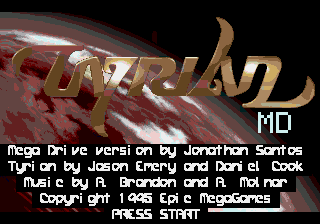
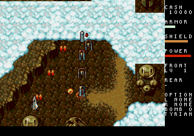
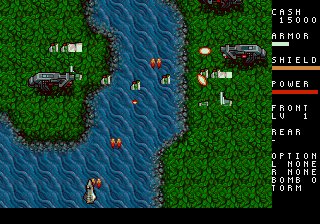
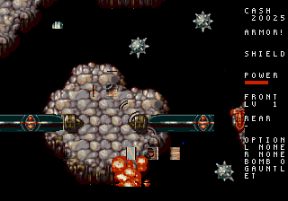
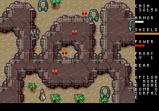
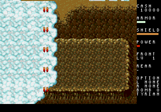
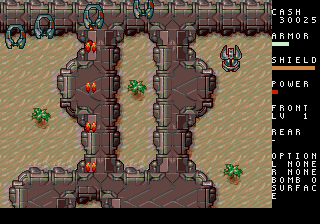

# Tyrian MD

**Tyrian on the Sega Mega Drive / Genesis — a port by Jonathan Santos.**

An unofficial, work-in-progress port of the classic vertical shooter to the
stock 68000, VDP, YM2612 and PSG. One **8 MiB / 64 Mbit SSF2 cartridge** contains
the four episodes from Tyrian 2.1. No Sega CD or 32X is required.



The port follows [OpenTyrian](https://github.com/opentyrian/opentyrian) for game
behavior and rebuilds the engine around Mega Drive hardware. It uses portable C
for the simulation, tile and sprite rendering on the VDP, streamed graphics,
and music converted to FM/PSG.

**This is not a finished release.** All four episode data sets are included in a
local build, but full-campaign completion, visual fidelity and real-hardware
validation are still in progress. Dense scenes currently slow down; sustained
60 Hz is a target, not a verified claim.

## Source-only distribution

The engine and conversion tools are **GPL-2.0-or-later**. Original Tyrian data
and converted assets are **not included** and are **not relicensed under GPL**.
OpenTyrian and SGDK are downloaded separately rather than vendored here.

There is intentionally **no complete ROM download** in this repository or its
GitHub releases: a complete `.bin` embeds copyrighted game data. The setup
script obtains the data locally from the source linked by OpenTyrian, verifies
the archive checksum, and lets you build the cartridge yourself. See
[LICENSE](LICENSE), [NOTICE](NOTICE) and the [asset policy](docs/licensing.md).

`make release` creates your local ROM in [`release/`](release/README.md).
The ROM and generated build metadata are ignored by Git.

## Screenshots

These are direct video captures of the ROM in **Genesis Plus GX**, using the
normal episode-selection menus. They are not PC screenshots or concept art.
Original Tyrian artwork remains the property of its creators.

| Episode 1 — Escape | Episode 2 — Treachery |
| --- | --- |
|  |  |
| **Episode 3 — Mission: Suicide** | **Episode 4 — An End to Fate** |
|  |  |

| Episode 1 — opening | Episode 4 — opening |
| --- | --- |
|  |  |

Capture instructions and provenance are in
[docs/screenshots/README.md](docs/screenshots/README.md).

## Build

### Requirements

The current development setup is macOS with Homebrew. Other systems need
compatible tools on `PATH`; a Windows-native build is not provided.

- Git, GNU Make, a native C compiler and `curl`.
- `m68k-elf-gcc`, binutils and libgcc for the bare-metal 68000 target.
- A Java runtime for SGDK's resource compiler.
- Python **3.11 or newer**, with the packages in `requirements.txt`.
- SDL2 development headers and `sdl2-config` for the music conversion helper.
- An SSF2-capable Mega Drive emulator or compatible flash cartridge to play.

On the tested Homebrew setup:

```sh
brew install m68k-elf-gcc sdl2 openjdk python
```

Make sure `java`, `m68k-elf-gcc` and `sdl2-config` are on `PATH`. Follow
Homebrew's displayed PATH instructions for its keg-only Java installation.

### Download and build

```sh
git clone https://github.com/jonathandasilvasantos/2026-tyrian-md.git
cd 2026-tyrian-md

python3 -m venv .venv
source .venv/bin/activate
python -m pip install -r requirements.txt

make bootstrap
make setup-sgdk
make release
```

The resulting cartridge is **`release/tyrian-md.bin`**; the working build is
`out/rom.bin`. `release/SHA256SUMS` records the checksum and
`release/build-info.json` records the source revision and dependency pins.
Builds made with uncommitted changes are marked accordingly.

`make bootstrap` downloads:

| Dependency | Local directory | Version / purpose |
| --- | --- | --- |
| OpenTyrian | `open-tyrian/` | Pinned revision; behavioral reference and host-side LDS/OPL conversion helper |
| SGDK | `sgdk/` | **v2.00**, pinned commit; Genesis runtime, resource compiler and build support |
| Tyrian 2.1 freeware data | `tyrian-data/` | SHA-256-verified archive; original graphics, music, levels and text |

All pins and download locations are in
[`tools/dependencies.lock.json`](tools/dependencies.lock.json). Existing
checkouts at a different revision are left untouched and reported as an error.
Downloaded dependency trees, data, caches and generated resources stay outside
Git. The downloader excludes the original DOS executables.

`make setup-sgdk` applies local compatibility adjustments to the downloaded SGDK
2.00 toolchain for modern GCC: stale LTO metadata/flags are removed and its
makefile is adjusted for dependency files. These changes are never vendored or
pushed upstream.

The first build converts all four episodes, all 41 music tracks and the sound
effects. It takes longer than an incremental build. Conversion output is
regenerated under `src/gen_data/` and `res/`; do not edit it by hand.

### Common commands

```sh
make rom                 # Unified cartridge in out/rom.bin
make rom EPISODE=2       # Same four-episode cartridge; episode 2 is the menu default
make release             # Build and package a complete ROM locally in release/
make host                # Native headless build of the same simulation
make test                # Converter/unit tests, ROM checks and host/68000 parity
make bench-68k           # Short 68000 timing/stack profile
make parity EPISODE=4    # One episode's opening replay against its golden state
make clean               # Remove working build outputs (out/)
```

`make clean` preserves downloaded dependencies, original data and local release
files. Full-level timing sweeps (`make bench-levels`) are deliberately manual.

### Run

Load `release/tyrian-md.bin` in an emulator that supports an **8 MiB Sega SSF2
mapper cartridge**. A plain 4 MiB linear-ROM loader is insufficient. Real
hardware requires a flash cartridge with compatible mapper support.

For Mednafen on macOS:

```sh
brew install mednafen
./play.sh
```

`play.sh` prepares an ignored compatibility copy for Mednafen's product-code
mapper lookup. The normal cartridge retains its Tyrian identity. Mednafen's
pad mapping can be configured with **Alt+Shift+1**; **Esc** exits.

## Controls

| Input | Action |
| --- | --- |
| D-pad | Move; enter original ship-combo directions |
| B | Fire main weapons and infinite-ammo sidekicks |
| C | Switch rear-weapon mode |
| A | Activate the left finite-ammo sidekick |
| Z, six-button pad | Activate the right finite-ammo sidekick / control its attachment |
| A, three-button pad | Activate both finite-ammo sidekicks |
| A / Z | Also release stocked superbombs |
| START | Pause / resume |

In menus, use the D-pad and **B or START** to select; **C** returns where
available. In a shop, **C** displays a 48-character checkpoint password.
Choose **Continue** at the title menu to enter it: left/right moves the cursor,
up/down changes a symbol, B advances, and A/START loads the code.

Passwords preserve equipment, cash, difficulty and episode progress and check
for transcription errors. They replace battery saves; the cartridge's ROM
mapping occupies the usual SRAM address range.

## What is implemented

- Four Tyrian 2.1 episodes, **62 level data sets**, episode selection and
  campaign progression carrying equipment and cash between episodes.
- Original event scripts, enemy behavior, front/rear weapons and power levels,
  shops and trade-in economy, generators, shields and armor.
- All **30 sidekicks**, charge/ammo behavior, superbombs, equipped specials,
  ship combos and scripted ENGAGE/GALAGA bonus behavior, including the linked
  second ship and its rotating gun/charge shots.
- Story text/pictures/music cues, datacube collection and reading with portraits,
  secret bonus destinations, level timers and low-armor warning cadence.
- Scrolling backgrounds, starfields/Astral effects, palette filters, HUD,
  explosions and projectile sparks within the hardware's limits.
- **41 music tracks** converted from LDS/OPL2 to YM2612/PSG, plus PCM effects
  and voices through XGM2.
- A shared deterministic simulation for the host and 68000 builds, tested on
  NTSC and PAL timing models.

### Remaining work and adaptations

The third/top background layer, per-enemy palette filters, story text glow,
picture pans, ending animation/credits, full mode selection, general two-player
play, Destruct, networking, jukebox and setup/configuration remain incomplete
or pending. The fifth episode is not part of the Tyrian 2.1 data set used here.
No missing data-dependent content is invented.

The renderer targets **320×224** with a compact HUD. Original PC coordinates
and gameplay tables are retained, while palettes, sprite composition and
render scheduling are adapted for the VDP. The simulation runs at **35 ticks/s**
on both 60 Hz NTSC and 50 Hz PAL displays, close to the original PC clock;
movement is interpolated between ticks. This does not guarantee that heavy
scenes meet the display-frame budget.

Music timbres, palette quantization, entity/effect caps and some presentation
choices differ from the PC. The detailed adaptation log, memory/VRAM budgets,
measurements and roadmap are maintained in [`agents.md`](agents.md).

## Testing and hardware limits

`make test` checks the converters, portable simulation, cartridge layout,
checksum, SSF2 bank mapping, stack reserve and recorded host/68000 state parity.
It covers the four openings and selected sidekick, special, combo, bonus,
checkpoint and scripted-mode cases in NTSC and PAL.

The 68000 runner uses an externally downloaded, pinned **Musashi** core. It
measures target instruction work; it does not model every VDP DMA/FIFO stall or
Z80 interaction. Short passing replays do not prove full-campaign completion,
visual accuracy or worst-case 60 Hz operation. Hardware testing and targeted
emulator profiling remain necessary.

## Project layout

| Path | Contents |
| --- | --- |
| `src/game/` | Portable gameplay simulation; no SGDK headers |
| `src/` | Genesis rendering, DMA, input, menus, HUD and sound |
| `tools/` | Download/bootstrap scripts, data converters, validation and capture tools |
| `platform/host/` | Native replay runner using the same game logic |
| `platform/genesis/` | Genesis build integration |
| `test/` | Unit/converter tests and recorded input/golden states |
| `docs/` | Data formats, licensing notes and documentary screenshots |
| `release/` | Instructions and ignored local cartridge output |

## Credits and license

Mega Drive version by **Jonathan Santos**. Original Tyrian programming/design
by **Jason Emery**, artwork by **Daniel Cook**, music by **Alexander Brandon**
and **Andreas Molnar**, and contributions by the rest of the original team.
Originally developed by Eclipse Software and published by Epic MegaGames.

This port builds on **The OpenTyrian Development Team's** work and uses
**Stephane Dallongeville's SGDK**. Names and trademarks belong to their
respective owners; this fan port is not endorsed by Sega or the original team.

Port source: **GPL-2.0-or-later**, see [LICENSE](LICENSE).
Dependencies retain their own licenses, see [NOTICE](NOTICE).
Game data and artwork depicted in screenshots are not covered by that GPL;
see [licensing and asset policy](docs/licensing.md).
